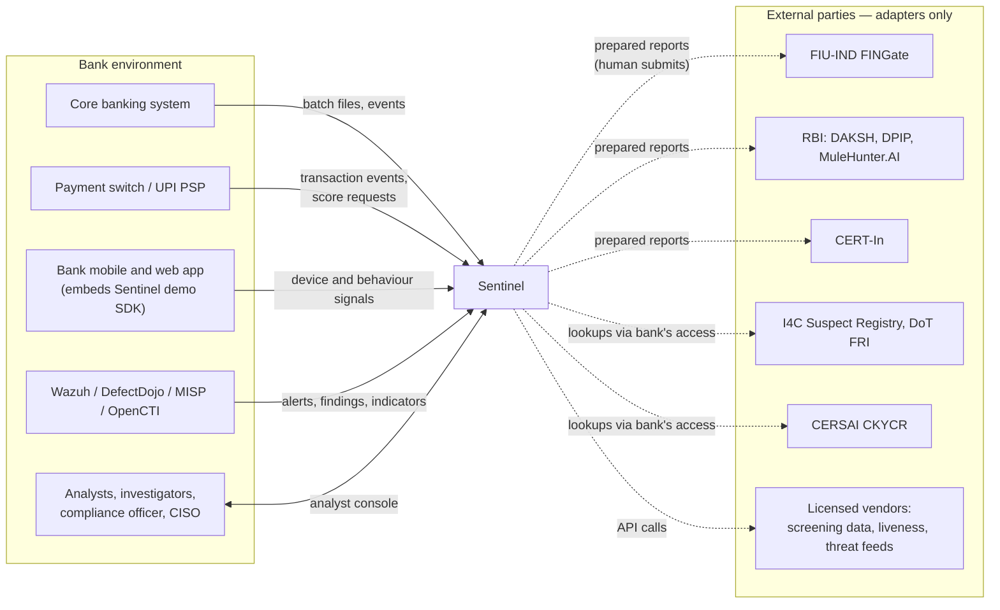
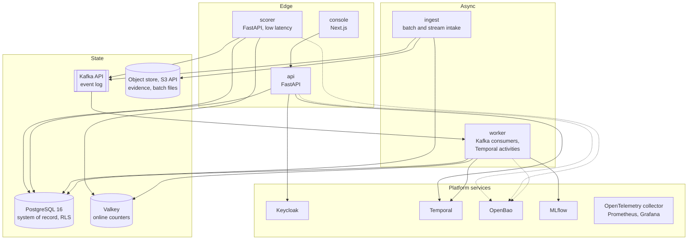
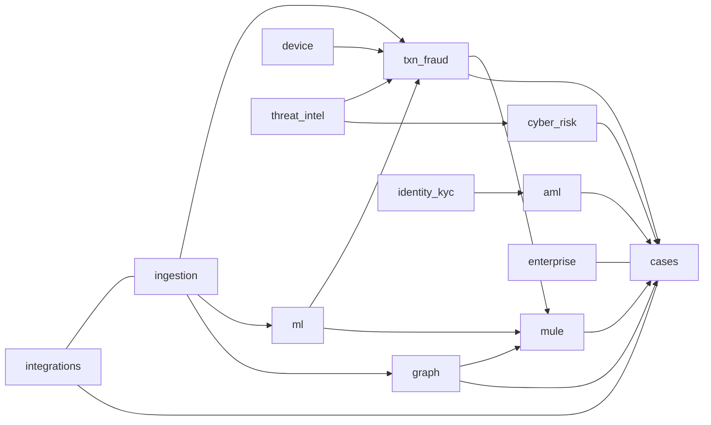
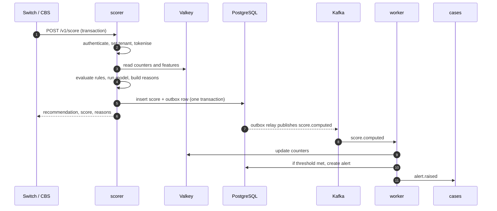
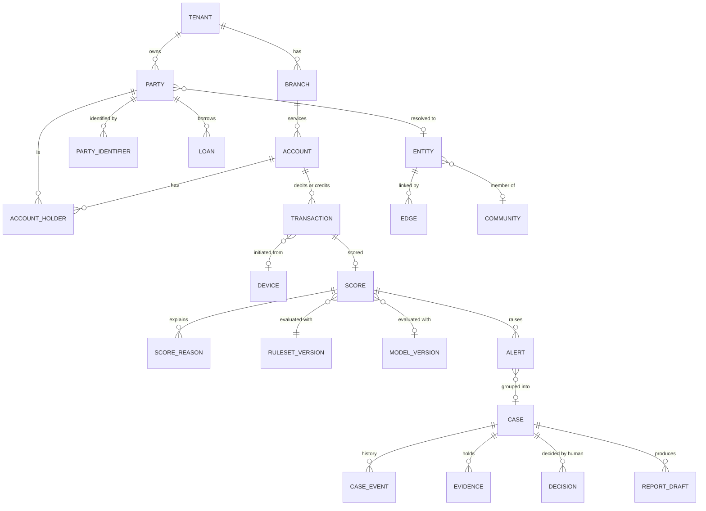
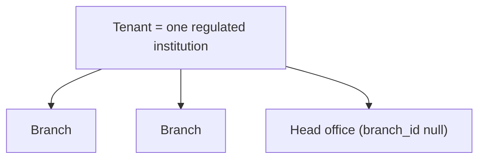
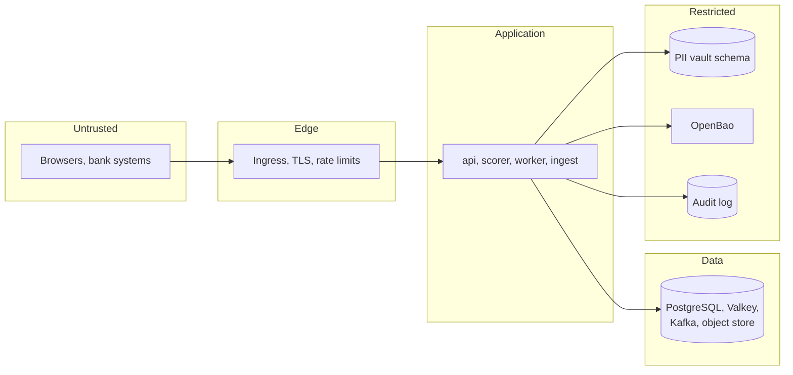
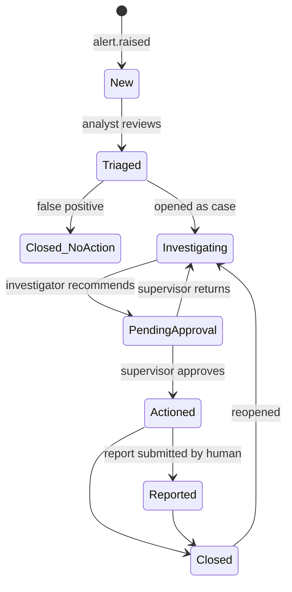

# Sentinel — architecture

Status: design, with Phase 2 (platform core) implemented. Version 0.2, 2026-11-10.
Where the built code differs from this document, the module READMEs and `CHANGELOG.md` say so.

Companion documents:

- Decisions and their reasons: [`docs/adr/`](docs/adr/README.md)
- REST contract: [`docs/api/openapi.yaml`](docs/api/openapi.yaml)
- Event contracts: [`docs/events/`](docs/events/README.md)
- Research and licence findings: [`research/`](research/README.md)

## 1. Scope and constraints

Sentinel is a fraud, AML and cyber-risk platform for Indian co-operative banks, small banks and NBFCs.
It has twelve capability groups. This design must hold all of them while only a few are built at a time.

Constraints that shape everything below:

| Constraint | Consequence |
|-----------|-------------|
| Small institutions with small IT teams | Few moving parts. One database. Runs on a single node in the smallest deployment. |
| Two delivery models: installed at a bank, or hosted for several banks | Tenant isolation is enforced in the database, not only in application code. Nothing source-available is shipped. |
| Humans decide; models recommend | No automated action freezes an account or files a report. Every score carries its reasons. Every decision can be overridden and the override is audited. |
| DPDP privacy by design | Purpose tags, retention schedules, tokenised PII and access logging are platform features, not module features. |
| No invented regulatory detail | Clause numbers, report formats and external API specifications live in a registry that records where each was verified. Unverified entries are stubs. |
| Synthetic data only | No real personal or banking data in the repo, tests or fixtures. |
| Defensive software only | No exploit code, credential harvesting, terms-violating scraping or access to systems without authority. |

Three choices differ from the baseline stack in the brief. Each has an ADR:

| Baseline | Chosen | ADR |
|----------|--------|-----|
| Neo4j or Memgraph | `GraphStore` port; PostgreSQL by default, Neo4j Community optional | [0004](docs/adr/0004-graph-store.md) |
| Redpanda | Kafka protocol; Redpanda in development, Apache Kafka in production | [0003](docs/adr/0003-event-streaming.md) |
| Vault or SOPS | OpenBao (Vault-compatible API) and SOPS | [0005](docs/adr/0005-secrets-and-keys.md) |

One component is added: Valkey for online velocity counters ([0010](docs/adr/0010-feature-store.md)).

## 2. System context



Dotted lines are adapter interfaces. Real connectivity needs bank-side agreements that do not exist
yet, so each ships with a synthetic stub. Sentinel **prepares** regulatory reports; a named human
reviews and submits them.

## 3. Containers



Four Python deployables, one codebase ([ADR 0001](docs/adr/0001-modular-monolith.md)):

| Deployable | Responsibility | Scaling |
|-----------|----------------|---------|
| `api` | All REST endpoints the console and integrations use, except scoring. Authn/authz, tenancy context, request audit. | Stateless, horizontal |
| `scorer` | `POST /v1/score` only. Loads active rules and models into memory, reads counters, returns a decision with reasons. | Stateless, horizontal, separately sized |
| `worker` | Kafka consumers (feature updates, alert creation, graph updates, enrichment) and Temporal workers (cases, reports, incidents). | By consumer group and task queue |
| `ingest` | Batch file intake, validation, quarantine, tokenisation, stream intake. | By partition |

In the smallest deployment all four run as one process group on one node.

## 4. Repository layout

```
apps/
  api/            FastAPI app: mounts each module's router
  scorer/         FastAPI app: scoring endpoint only
  worker/         Kafka consumers and Temporal workers
  ingest/         batch and stream intake
  console/        Next.js analyst console (TypeScript strict)
packages/
  sentinel_core/  tenancy, auth, audit, crypto, tokenisation, outbox, purpose tags, config, telemetry
  sentinel_sdk/   demo device and behaviour SDK (TypeScript)
modules/
  ingestion/      group: platform         phase 2
  synth/          synthetic data          phase 3
  txn_fraud/      group 3                 phase 4
  mule/           group 4                 phase 4
  cases/          group 8                 phase 5
  graph/          group 5                 phase 6
  aml/            group 7                 phase 7
  ml/             group 9                 phase 8
  threat_intel/   group 6                 phase 9
  identity_kyc/   group 1                 phase 10
  device/         group 2                 phase 10
  cyber_risk/     group 10                phase 11
  integrations/   group 11                phase 12
  enterprise/     group 12                phase 12
deploy/
  compose/        docker-compose for development
  helm/           charts (later)
docs/             adr/, api/, events/
research/         phase 0 output
```

### Module shape

Every module has the same internal layout:

```
modules/<name>/
  README.md        what it does, how to run it, its limits
  public.py        the only file other modules may import
  domain/          entities and pure logic, no I/O
  ports.py         interfaces this module needs from the outside world
  adapters/        implementations of ports (database, vendors, stubs)
  api.py           FastAPI router
  consumers.py     event handlers
  workflows.py     Temporal workflows and activities
  migrations/      this module's tables only
  tests/
```

Rules, enforced in CI by `import-linter`:

1. A module imports `sentinel_core` and other modules' `public.py`. Nothing else.
2. `domain/` imports no framework, no database driver, no HTTP client.
3. A module writes only to its own tables. It reads another module's data through that module's
   `public.py` or by consuming its events.
4. Every external system is reached through a port with at least two adapters: the real one and a
   deterministic stub used in tests and demos ([ADR 0011](docs/adr/0011-integration-adapters.md)).

Because modules talk through `public.py` and events, any module can later be moved into its own
service without changing its callers.

## 5. Module map



Arrows show the direction of data flow, all of it by events except the `scorer`'s in-process calls.

| Module | Owns | Emits | Consumes |
|--------|------|-------|----------|
| `ingestion` | Batch jobs, quarantine, canonical party/account/transaction records | `party.upserted`, `account.upserted`, `transaction.received` | — |
| `txn_fraud` | Rules, rule versions, backtests, counters, scores | `score.computed`, `alert.raised` | `transaction.received`, `device.signal.received`, `indicator.matched` |
| `mule` | Mule risk scores, rapid-movement and circular-flow findings | `mule.risk.updated`, `alert.raised` | `transaction.received`, `graph.community.updated` |
| `cases` | Alerts, cases, evidence, notes, tasks, decisions | `case.updated`, `decision.recorded` | `alert.raised` |
| `graph` | Resolved entities, edges, communities, propagated risk | `entity.resolved`, `graph.community.updated` | `party.upserted`, `transaction.received` |
| `aml` | Typologies, screening hits, risk categories, STR/CTR drafts | `screening.hit`, `report.drafted`, `alert.raised` | `party.upserted`, `transaction.received`, `decision.recorded` |
| `ml` | Feature definitions, training runs, model versions, monitoring | `model.promoted`, `drift.detected` | `decision.recorded`, `score.computed` |
| `threat_intel` | Indicators, feed runs, enrichment | `indicator.matched` | — |
| `identity_kyc` | KYC checks, document extraction, liveness results | `kyc.check.completed` | — |
| `device` | Device and session signals | `device.signal.received` | — |
| `cyber_risk` | Incidents, controls, third parties, findings | `incident.opened`, `alert.raised` | SOC tool webhooks |
| `integrations` | CBS connectors, webhooks, notifications | — | most events |
| `enterprise` | Retention jobs, usage metering, licence state, dashboards | `retention.executed` | most events |

## 6. Real-time scoring path

Target: **p95 under 150 ms** at the `scorer` boundary, measured in CI on synthetic load
(Phase 4). The budget below is a design target, not a measurement.

| Step | Budget |
|------|--------|
| TLS, auth token check (cached keys), tenancy context | 10 ms |
| Tokenise identifiers in the request | 5 ms |
| Read counters and cached entity features (one pipelined Valkey round trip) | 10 ms |
| Evaluate active rule set (in memory) | 15 ms |
| Model inference (LightGBM, in memory) | 20 ms |
| Assemble reasons, write to outbox, respond | 20 ms |
| Headroom | 70 ms |



Design points:

- The scorer returns a **recommendation** (`allow`, `review`, `hold_for_review`). Whether the bank's
  switch acts on it is the bank's configuration. Sentinel never moves or blocks money itself.
- If Valkey or the model is unavailable the scorer degrades to rules-only and marks the response
  `degraded: true`. It never fails open silently.
- The scorer holds rule sets and models in memory and refreshes them on `rule.activated` and
  `model.promoted` events, with a periodic poll as a safety net.
- The score row and its outbox row commit together ([ADR 0013](docs/adr/0013-transactional-outbox.md)),
  so no score exists without an event and no event without a score.

## 7. Data model

### 7.1 Conventions

Every tenant-scoped table has:

| Column | Purpose |
|--------|---------|
| `id uuid` | UUIDv7, time-ordered |
| `tenant_id uuid not null` | Row-level security key |
| `branch_id uuid null` | Optional second-level scope |
| `created_at`, `updated_at timestamptz` | UTC |
| `row_version int` | Optimistic concurrency |

Schemas are per module (`ingestion.*`, `cases.*`, …). Money is `numeric(18,2)` with an ISO 4217 code.
Times are stored in UTC and shown in IST by the console.

Every column holding personal data is declared in a **data catalogue** table with a classification
and one or more purpose tags (section 9.4). A CI check fails if a migration adds a column that is not
in the catalogue.

### 7.2 Core entities



### 7.3 Table catalogue

| Schema | Tables | Notes |
|--------|--------|-------|
| `core` | `tenant`, `branch`, `user_profile`, `role_assignment`, `tenant_key`, `data_catalogue`, `purpose`, `retention_policy`, `legal_hold`, `audit_event`, `outbox`, `regulatory_reference` | `audit_event` is append-only and hash-chained |
| `vault` | `pii_token` | Token → ciphertext. Separate schema, separate database role |
| `ingestion` | Built: `batch_job`, `batch_queue`, `quarantine_record`, `party`, `account`, `loan`, `device_link`, `transaction`, `transaction_ref`. Planned: `party_identifier`, `account_holder`, `counterparty` | `transaction` is partitioned by month; `transaction_ref` makes ingestion idempotent |
| `txn_fraud` | `rule`, `rule_version`, `ruleset_version`, `backtest_run`, `backtest_result`, `score`, `score_reason`, `threshold_profile` | Rule versions are immutable |
| `mule` | `mule_risk`, `flow_finding` | |
| `cases` | `alert`, `case`, `case_event`, `case_assignment`, `evidence`, `note`, `task`, `decision`, `ai_summary` | `ai_summary` stores the evidence ids it used |
| `graph` | `entity`, `entity_member`, `edge`, `community`, `risk_propagation_run` | Edge list; see ADR 0004 |
| `aml` | `typology`, `screening_request`, `screening_hit`, `risk_category`, `cdd_review`, `report_draft`, `report_submission_record` | Submission is recorded, not performed |
| `ml` | `feature_definition`, `feature_value_offline`, `training_run`, `model_version`, `model_approval`, `monitoring_snapshot` | Mirrors MLflow ids |
| `threat_intel` | `feed`, `feed_run`, `indicator`, `indicator_sighting` | `feed.licence_acknowledged_by` is mandatory |
| `identity_kyc` | `kyc_check`, `document_extraction`, `liveness_result` | Images in the object store, not the database |
| `device` | `device`, `device_signal`, `session` | Each signal carries consent reference and purpose |
| `cyber_risk` | `incident`, `incident_obligation`, `control`, `control_assessment`, `third_party`, `finding` | One `incident_obligation` per regulator clock |
| `integrations` | `connector`, `webhook_endpoint`, `webhook_delivery`, `notification` | |
| `enterprise` | `usage_event`, `licence`, `dashboard_definition`, `retention_run` | |

Field-level definitions are written with each module's migrations in its own phase. This catalogue
fixes ownership and names so that modules built later do not collide.

### 7.4 Feature store pattern

Lightweight, SQL-first ([ADR 0010](docs/adr/0010-feature-store.md)):

- A **feature definition** is a named, versioned record: entity type, SQL expression or windowed
  aggregate, window, owner and purpose tag.
- **Offline**: features are computed by SQL over `ingestion.transaction` *as of* a timestamp.
  Training sets and backtests use the same definitions, so there is no training/serving skew by
  construction for SQL features.
- **Online**: windowed aggregates (count, sum, distinct count over 1 minute to 30 days) are kept as
  time-bucketed counters in Valkey, updated by the worker from `transaction.received`. Slow-moving
  features are cached from PostgreSQL with a TTL.
- A nightly job recomputes a sample of online values offline and reports any mismatch. That report
  is a CI-visible metric.
- Valkey holds only tokens and numbers. It can be rebuilt from the event log.

## 8. Events

All events share one envelope ([`docs/events/envelope.schema.json`](docs/events/envelope.schema.json)).
Payloads are JSON validated against JSON Schema; schemas are versioned and only changed in
backward-compatible ways within a major version.

| Property | Rule |
|----------|------|
| Topic | `sentinel.<module>.<entity>.v<major>`, for example `sentinel.ingestion.transaction.v1` |
| Key | `tenant_id` + the entity's natural partition key (account token for transactions) |
| Ordering | Per key |
| Delivery | At least once. Consumers are idempotent on `event_id` |
| PII | **Tokens only.** No raw personal data on the bus |
| Tenancy | `tenant_id` in the envelope and as a record header. Consumers set the database tenant context from it |
| Publishing | Through the transactional outbox only |
| Failures | Retries with backoff, then a per-consumer dead-letter topic with an operator view |

Schemas defined in Phase 1: `transaction.received`, `score.computed`, `alert.raised`,
`case.updated`, `decision.recorded`. Others are added with their modules.

## 9. Multi-tenancy

[ADR 0002](docs/adr/0002-multi-tenancy.md).



### 9.1 Database

- One database, shared schemas, **row-level security on every tenant-scoped table**, with
  `FORCE ROW LEVEL SECURITY` so that table owners are also bound.
- The application connects as a role that is not a table owner and has no `BYPASSRLS`.
- Each transaction begins with `SET LOCAL app.tenant_id` (and `app.branch_ids` for branch-scoped
  roles). Policies compare `tenant_id` to that setting. A connection without the setting sees no rows.
- Migrations run as a separate owner role that the application never uses.
- A test in every module's suite opens a session as tenant A and asserts that every table returns
  zero rows belonging to tenant B. A new table without a policy fails CI.
- A bank that requires physical isolation gets its own database or its own installation. The code
  path is identical.

### 9.2 Everything else

| Layer | Isolation |
|-------|-----------|
| Identity | One Keycloak realm per tenant. Tokens carry `tenant_id` and `branch_ids` |
| Events | Shared topics, tenant in key and header; consumers set tenant context per record |
| Valkey | Key prefix `t:{tenant_id}:` built by one helper; no ad-hoc keys |
| Object store | Prefix per tenant, per-tenant data key |
| Encryption | Per-tenant key-encryption key in OpenBao (section 10.3) |
| Temporal | Tenant id in workflow id and as a search attribute; activities set tenant context |
| Models | Trained per tenant by default. Cross-tenant training is off and would need contract and consent |
| Rules, thresholds, feeds | Per tenant, with optional platform-provided templates that are copied, not shared |
| Rate limits and quotas | Per tenant at the gateway |

### 9.3 Branch scope

Roles are either institution-wide or branch-scoped. Branch-scoped users see rows where
`branch_id` is in their set. Cases can be escalated from branch to head office, which changes the
case's scope and is audited.

### 9.4 Purpose tags and retention

- Each catalogue entry lists the purposes for which the column may be processed, for example
  `fraud_prevention`, `aml_compliance`, `kyc`, `security_monitoring`, `service_operations`.
- Each API handler and consumer declares the purpose it acts under. The data-access layer refuses to
  return a tokenised field's clear value if the caller's purpose is not on the column.
- Each purpose has a retention policy per tenant. A daily workflow erases or anonymises expired data,
  skips anything under legal hold, and writes a `retention.executed` event.
- Retention periods are tenant configuration. Defaults are left unset until the governing rules are
  verified from primary sources (research item 5).

## 10. Security architecture

### 10.1 Trust zones



Network policy allows only the arrows shown. Internal traffic uses mutual TLS.

### 10.2 Identity and access

- Keycloak, OIDC authorisation code with PKCE for the console; client credentials for systems.
  MFA is required for every human role.
- Baseline roles: `analyst`, `investigator`, `supervisor`, `compliance_officer`, `rule_author`,
  `rule_approver`, `model_approver`, `ciso`, `tenant_admin`, `auditor` (read-only), and
  `platform_operator` (no access to tenant data).
- **Maker–checker** on anything that changes detection behaviour or produces a regulatory artefact:
  rule activation, threshold change, model promotion, report finalisation. The author cannot approve
  their own change.
- Clear PII is shown only on an explicit **reveal** action that records user, case, field and reason.

### 10.3 Encryption and keys

[ADR 0005](docs/adr/0005-secrets-and-keys.md).

- TLS 1.2 or later everywhere in transit.
- Envelope encryption at rest: each tenant has a key-encryption key in OpenBao's transit engine.
  Data-encryption keys are generated per tenant and purpose, stored wrapped, cached in memory briefly.
- Rotating a tenant's key re-wraps data keys without rewriting data. Destroying it makes that
  tenant's PII unreadable, which is the offboarding mechanism.
- Application secrets come from OpenBao at runtime. Configuration secrets in git are SOPS-encrypted.
  No secret appears in an image, environment file or log.

### 10.4 PII tokenisation

[ADR 0007](docs/adr/0007-pii-tokenisation.md).

- At ingestion, direct identifiers (name, PAN, Aadhaar-derived references, phone, email, address,
  account number, VPA, device identifiers, IP address) are replaced by tokens.
- Tokens are **deterministic per tenant and field type** (keyed HMAC), so equality joins, velocity
  counters and graph links work on tokens without decryption, and tokens cannot be correlated
  across tenants.
- The clear value is stored encrypted in the `vault` schema, reachable only through the
  tokenisation service under a database role the other modules do not have.
- Entity resolution needs fuzzy comparison. It uses derived, non-reversible comparison keys
  (normalised phonetic and n-gram hashes) produced at ingestion, not clear values.
- Events, logs, traces, metrics, model features and Valkey contain tokens only.

### 10.5 Audit log

[ADR 0008](docs/adr/0008-audit-log.md).

- Append-only table; the application role has `INSERT` and `SELECT` only.
- Each record stores the hash of the previous record for the same tenant, so removal or alteration
  breaks the chain.
- The chain head is periodically anchored outside the database (signed, written to the object store
  with object lock where available).
- `GET /v1/audit/verify` recomputes the chain and reports the first break.
- Recorded: authentication, every read of clear PII, every change to rules, models, thresholds,
  cases, decisions and reports, every export, and every administrative action.

### 10.6 Application security

- Input validated by Pydantic at every boundary; rules are data evaluated by an interpreter with no
  code execution path ([ADR 0006](docs/adr/0006-rule-engine.md)).
- Outbound calls only to hosts on a per-adapter allow-list.
- Dependencies pinned with hashes; CI runs vulnerability and licence scans and blocks on policy
  violations; images are built from minimal bases, run as non-root and are signed.
- Language-model features are read-only, tenant-scoped, see tokens rather than clear PII, and must
  cite the records they used ([ADR 0014](docs/adr/0014-llm-usage.md)).

## 11. Decisions, explanations and overrides

[ADR 0012](docs/adr/0012-human-in-the-loop.md).



- Every score stores: the rule versions that fired with the values that triggered them, the model
  version, its top feature contributions, and the thresholds in force.
- A human can override any recommendation. The override needs a reason and becomes a training label.
- Actions with external effect (requesting a freeze, filing a report, notifying a regulator) are
  Temporal workflow steps that **wait for a named human approval signal**. There is no code path that
  performs them automatically.
- AI-generated summaries are stored separately from human notes, displayed as drafts, and list the
  evidence ids they were built from.

## 12. Regulatory reference registry

[ADR 0016](docs/adr/0016-regulatory-reference-registry.md).

`core.regulatory_reference` holds every external obligation the software encodes: instrument title,
reference number, paragraph, date, source URL, the date it was verified and by whom, and a status of
`verified`, `secondary_only` or `unverified`.

- Deadlines, thresholds, report layouts and control lists are **configuration that points at a
  registry entry**, never constants in code.
- A feature whose registry entry is not `verified` runs in draft mode: it produces internal
  artefacts but its export is disabled and the console shows why.
- When an instrument is replaced, as happened on 31 July 2026, the entry is superseded and the
  dependent configuration is flagged for review.

## 13. Observability

- OpenTelemetry traces, metrics and logs from every deployable; Prometheus and Grafana for storage
  and display.
- Structured JSON logs with `tenant_id`, `trace_id`, `actor_id` and tokens only. A log-scrubbing
  filter plus a CI test that feeds synthetic PII through each logger guard against leaks.
- Service-level indicators from Phase 4: scoring latency (p50, p95, p99), error rate, consumer lag,
  outbox delay, alert-creation delay, workflow backlog.
- Model and rule monitoring: alert volumes, precision and recall against labels, drift, and override
  rate, per tenant.

## 14. Deployment

| Environment | Shape |
|------------|-------|
| Development | `docker-compose`: PostgreSQL, Redpanda, Valkey, Temporal, Keycloak, OpenBao (dev mode), MLflow, object store, the four apps and the console. `make up`, `make seed`, `make demo`, `make test`. |
| Single bank, small | One or two nodes. Apps as one process group. PostgreSQL with streaming replica. |
| Hosted, multi-tenant | Kubernetes via Helm. Apache Kafka. Apps scaled independently. Per-tenant realms and keys. |

Data residency: all data stores and logs stay in India. Clocks synchronise to the sources the
bank is required to use.

## 15. Quality gates

| Gate | Tool |
|------|------|
| Types | `mypy --strict`, TypeScript `strict` |
| Lint and format | `ruff`, `eslint`, `prettier` |
| Module boundaries | `import-linter` |
| Unit tests | `pytest`, one test file per rule and per feature |
| Integration tests | `pytest` with Testcontainers (real PostgreSQL, Kafka API, Valkey, Temporal) |
| Tenant isolation | Cross-tenant test per table, required |
| End to end | Playwright on the console's main flows |
| Contracts | OpenAPI and JSON Schema validated; generated clients compiled |
| Detection quality | Precision and recall per fraud type on synthetic labels, reported in CI |
| Performance | Scoring latency benchmark, reported in CI |
| Supply chain | Vulnerability scan, licence allow-list |
| Coverage | Reported in CI |

## 16. What Phase 1 leaves open

1. **The 185-item capability list has not been received.** The module map covers the twelve groups
   and every capability named in the brief. Each of the 185 items must be assigned to a module when
   the list arrives; a capability that fits none would mean a new module, not a redesign.
2. Field-level schemas are fixed per module in its own phase.
3. Choice of rule-expression evaluator (in-house interpreter or GoRules Zen) follows a latency spike
   in Phase 4.
4. Apache AGE as an alternative graph query layer is assessed in Phase 6.
5. Development object store: needs a licence check before pinning.
6. Regulatory items 2 to 8 in `research/RESEARCH.md` section 14 remain unverified.
